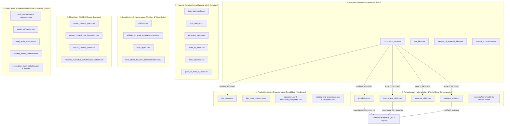

# Panduan dan Penjelasan Dataset O*NET (Release 31.0)
## untuk Expert System Evaluasi Kurikulum Akademik Berbasis Kompetensi

> **Terkait dengan:** [rencana_expert_system_evaluasi_kurikulum.md](file:///d:/PELAJARAN/Semester%205/KBR/Projek/rencana_expert_system_evaluasi_kurikulum.md)  
> **Versi Database:** O*NET 31.0 Database (Release Agustus 2026)  
> **Jumlah File:** 45 File CSV (+ 1 file dokumentasi `Read Me.txt`)  
> **Tujuan:** Menjelaskan secara rinci fungsi, struktur data/skema kolom, serta peran strategis setiap dataset O*NET dalam membangun basis pengetahuan (*knowledge base*), inferensi bobot (*importance*), penetapan standar kedalaman kompetensi (*level*), dan evaluasi keselarasan kurikulum akademik di bidang IT.

---

## 1. Pendahuluan & Posisi O*NET dalam Sistem Pakar

Dalam sistem evaluasi kurikulum akademik berbasis kompetensi, klasifikasi **ESCO** dan database **O*NET** saling melengkapi:
- **ESCO** menyediakan taksonomi keterampilan granular dan hubungan kategorial (`essential` vs `optional`).
- **O*NET** menyediakan **ukuran empiris terstandarisasi** mengenai seberapa penting suatu kompetensi (*Importance*) dan seberapa tinggi kedalaman yang dibutuhkan (*Level*) di dunia kerja nyata.

### Dua Metrik Kunci O*NET untuk Rule Engine:
1. **Importance (IM, Skala 1.00 – 5.00)**:
   - Menunjukkan seberapa penting elemen pengetahuan atau keterampilan bagi suatu pekerjaan.
   - Digunakan dalam sistem pakar sebagai **bobot dasar ($w_i$)** pada perhitungan *Weighted Coverage Rate* (WCR).
2. **Level (LV, Skala 0.00 – 7.00)**:
   - Menunjukkan tingkat kemahiran atau kedalaman penguasaan yang dibutuhkan di lapangan.
   - Dilengkapi dengan *behavioral anchors* (jangkar perilaku nyata).
   - Digunakan dalam sistem pakar sebagai **standar target kedalaman ($L_{req}$)** yang harus dicapai oleh Capaian Pembelajaran Mata Kuliah (CPMK) dan materi silabus/RPS kurikulum.

---

## 2. Peta Fungsional 45 File Dataset O*NET

Seluruh 45 file CSV dikelompokkan ke dalam **7 Kelompok Fungsional**:

---

## 3. Penjelasan Lengkap Tiap Dataset

---

### KELOMPOK 1: Informasi Pekerjaan & Gelar (*Core Occupation & Job Titles*)

Kelompok ini memuat master data seluruh jabatan pekerjaan standar O*NET-SOC serta variasi penamaan posisi kerja di industri.

#### 1. `occupation_data.csv`
* **Status**: 🔴 **Wajib (Katalog Pekerjaan)**
* **Definisi**: Master tabel yang memuat seluruh pekerjaan yang terdaftar dalam taksonomi O*NET Standard Occupational Classification (SOC).
* **Kolom Kunci**:
  * `O*NET-SOC Code`: Kode standar pekerjaan (format `XX-XXXX.XX`, contoh: `15-1252.00` untuk *Software Developers*).
  * `Title`: Nama resmi jabatan (contoh: *Software Developers*, *Data Scientists*, *Computer Network Architects*).
  * `Description`: Deskripsi komprehensif mengenai tanggung jawab utama dan cakupan peran pekerjaan tersebut.
* **Fungsi dalam Sistem Pakar**:
  * Menjadi entitas utama `Occupation` pada Knowledge Graph.
  * Memungkinkan penyaringan fokus bidang IT menggunakan prefix kode SOC **`15-xxxx.xx`** (*Computer and Mathematical Occupations*).

#### 2. `job_titles.csv`
* **Status**: 🟡 **Sangat Disarankan (Kamus Alias / Sinonim)**
* **Definisi**: Daftar komprehensif berisi ratusan ribu variasi judul posisi pekerjaan alternatif yang lazim dipakai di industri dan lowongan kerja riil.
* **Kolom Kunci**: `O*NET-SOC Code`, `Title`, `Job Title`, `Short Title`, `Source(s)`.
* **Fungsi dalam Sistem Pakar**:
  * Membantu modul *Natural Language Processing* (NLP) dan *entity linking* dalam memetakan profil lulusan yang tertulis pada kurikulum (misal: kurikulum menulis "Cloud Engineer", sistem memetakannya ke `15-1252.00 Software Developers` atau `15-1243.00 Database Architects`).

#### 3. `sample_of_reported_titles.csv`
* **Status**: 🟢 **Pendukung UI & Pencarian**
* **Definisi**: Sampel judul jabatan kerja riil paling populer yang dilaporkan langsung oleh para pekerja industri saat pengisian survei O*NET.
* **Kolom Kunci**: `O*NET-SOC Code`, `Title`, `Reported Job Title`, `Shown in My Next Move`.
* **Fungsi dalam Sistem Pakar**:
  * Menyediakan saran (*autocomplete/suggestion*) pada antarmuka pengguna sistem pakar saat pengguna memilih profil karir sasaran evaluasi.

#### 4. `related_occupations.csv`
* **Status**: 🟡 **Sangat Disarankan (Inferensi Kedekatan Karir)**
* **Definisi**: Matriks relasi yang menghubungkan suatu pekerjaan dengan pekerjaan lain yang memiliki kesamaan profil tugas, pengetahuan, dan keterampilan.
* **Kolom Kunci**:
  * `O*NET-SOC Code` & `Title`: Pekerjaan asal.
  * `Related O*NET-SOC Code` & `Related Title`: Pekerjaan terkait.
  * `Relatedness Tier`: Tingkat kedekatan hubungan (`Primary-Short`, `Primary-Long`, `Secondary-Short`, `Secondary-Long`).
  * `Index`: Urutan ranking kesamaan.
* **Fungsi dalam Sistem Pakar**:
  * Memberikan rekomendasi perluasan karir (*career pathway suggestion*): Jika sebuah kurikulum memiliki keselarasan tinggi untuk *Web Developer*, sistem dapat menginferensi seberapa jauh kurikulum tersebut dari *Software Quality Assurance Analyst*.

---

### KELOMPOK 2: Kebutuhan Pengetahuan, Keterampilan & Tools (*Core Competencies*)

Kelompok ini adalah **inti terpenting** dari database O*NET untuk proyek evaluasi kurikulum akademik, karena menyediakan data kuantitatif (*Importance* dan *Level*) untuk materi kuliah dan keahlian teknis.

#### 5. `knowledge.csv`
* **Status**: 🔴 **Wajib (Fondasi Teori & Ranah Kognitif Kurikulum)**
* **Definisi**: Memuat 33 area pengetahuan terstruktur (misal: *Computers and Electronics*, *Engineering and Technology*, *Mathematics*, *Telecommunications*, *Design*) yang dibutuhkan oleh setiap pekerjaan.
* **Kolom Kunci**:
  * `O*NET-SOC Code`, `Title`: Identitas pekerjaan.
  * `Element ID`, `Element Name`: Kode dan nama area pengetahuan (misal `2.C.3.a Computers and Electronics`).
  * `Scale ID`, `Scale Name`: Tipe skala penilaian:
    * **`IM` (Importance)**: Skala 1.00 – 5.00 (Tingkat kepentingan materi).
    * **`LV` (Level)**: Skala 0.00 – 7.00 (Tingkat kedalaman penguasaan teori).
  * `Data Value`: Nilai numerik hasil survei.
* **Fungsi dalam Sistem Pakar**:
  * **Tolok Ukur Evaluasi Mata Kuliah Teoretis**: Sangat cocok diselaraskan dengan Capaian Pembelajaran Lulusan (CPL) aspek Pengetahuan.
  * **Penetapan Bobot Mata Kuliah**: Nilai `IM` menjadi bobot $w_i$ untuk mengukur seberapa krusial suatu mata kuliah dasar/keilmuan dalam kurikulum.

#### 6. `transferable_skills.csv`
* **Status**: 🔴 **Wajib (Keterampilan Terapan & Problem Solving)**
* **Definisi**: Berisi data *Cross-Functional Skills* (keterampilan lintas fungsi/terapan) seperti *Programming*, *Complex Problem Solving*, *Systems Analysis*, *Systems Evaluation*, *Technology Design*, dan *Critical Thinking*.
* **Kolom Kunci**: `O*NET-SOC Code`, `Title`, `Element ID`, `Element Name`, `Scale ID` (`IM` & `LV`), `Data Value`.
* **Fungsi dalam Sistem Pakar**:
  * **Tolok Ukur Evaluasi Praktikum & Capstone Project**: Menilai apakah kurikulum melatih mahasiswa memecahkan masalah kompleks (*Complex Problem Solving*) dan merancang arsitektur sistem (*Systems Analysis*).
  * Menjadi target pemetaan utama untuk CPMK mata kuliah rekayasa perangkat lunak dan pemrograman.

#### 7. `essential_skills.csv`
* **Status**: 🟡 **Sangat Disarankan (Keterampilan Dasar / Literasi)**
* **Definisi**: Berisi data *Basic Skills* (keterampilan dasar proses dan konten) seperti *Reading Comprehension*, *Active Listening*, *Writing*, *Speaking*, *Mathematics*, *Science*, *Active Learning*, *Learning Strategies*, dan *Monitoring*.
* **Kolom Kunci**: `O*NET-SOC Code`, `Title`, `Element ID`, `Element Name`, `Scale ID` (`IM` & `LV`), `Data Value`.
* **Fungsi dalam Sistem Pakar**:
  * Menilai keselarasan mata kuliah umum (MKU) dan mata kuliah pembentuk karakter belajar mandiri (*lifelong learning*), seperti Matematika Diskrit, Bahasa Inggris Teknis, dan Metodologi Ilmiah.

#### 8. `software_skills.csv`
* **Status**: 🔴 **Wajib (Teknologi Spesifik & Hot Technologies)**
* **Definisi**: Katalog piranti lunak, bahasa pemrograman, *framework*, database, dan tools spesifik yang digunakan oleh profesional di setiap pekerjaan O*NET.
* **Kolom Kunci**:
  * `O*NET-SOC Code`, `Title`: Pekerjaan sasaran.
  * `Workplace Example`: Nama software/teknologi nyata (contoh: *Python*, *Docker*, *PostgreSQL*, *TensorFlow*, *Kubernetes*, *Git*).
  * `Element ID`, `Element Name`: Kategori software (contoh: `2.E.1.a Development software`).
  * `Hot Technology`: Bernilai `Y` jika teknologi tersebut saat ini sangat dicari dan populer di industri.
  * `In Demand`: Bernilai `Y` jika teknologi tersebut banyak tercantum dalam lowongan kerja aktif.
* **Fungsi dalam Sistem Pakar**:
  * **Audit Modernitas Silabus / RPS**: Mengecek apakah materi kuliah mengajarkan tools yang mutakhir (*Hot Technology*). Jika kurikulum IT masih mengajarkan tools usang dan melewatkan *Hot Technology*, sistem akan memunculkan rekomendasi peremajaan silabus.

#### 9. `essential_skills_to_work_activities.csv` & `essential_skills_to_work_context.csv`
* **Status**: 🟢 **Pendukung Inferensi Semantik**
* **Definisi**: Tabel pemetaan konseptual yang menghubungkan *Essential Skills* ke aktivitas kerja nyata (*Work Activities*) dan konteks kerja (*Work Context*).
* **Fungsi dalam Sistem Pakar**: Memperkuat penjelasan sistem (*explanation facility*) saat dosen bertanya mengapa suatu skill literasi perlu diajarkan di kurikulum.

#### 10. `transferable_skills_to_work_activities.csv` & `transferable_skills_to_work_context.csv`
* **Status**: 🟢 **Pendukung Inferensi Semantik**
* **Definisi**: Tabel relasi antara *Transferable Skills* (seperti *Systems Analysis*) ke tugas-tugas kerja konkret.
* **Fungsi dalam Sistem Pakar**: Menjadi jembatan inferensi saat memetakan portofolio/tugas akhir mahasiswa terhadap kebutuhan aktivitas nyata dunia kerja.

---

### KELOMPOK 3: Tugas Kerja & Aktivitas Pekerjaan (*Tasks & Work Activities*)

Kelompok ini memuat rincian aktivitas dari level paling umum (*Generalized Work Activities*) hingga tugas pekerjaan yang sangat spesifik (*Task Statements* dan *Detailed Work Activities*).

#### 11. `task_statements.csv`
* **Status**: 🟡 **Sangat Disarankan (Audit Rincian RPS & Praktikum)**
* **Definisi**: Uraian kalimat tugas rinci yang dilakukan oleh seorang profesional dalam pekerjaan tertentu.
* **Kolom Kunci**:
  * `O*NET-SOC Code`, `Title`: Pekerjaan.
  * `Task ID`: ID unik kalimat tugas.
  * `Task`: Teks deskripsi tugas lengkap (contoh: *"Modify existing software to correct errors, adapt it to new hardware, or upgrade interfaces and improve performance"*).
  * `Task Type`: Status kepentingan tugas (`Core` = tugas primer wajib, `Supplemental` = tugas sekunder).
* **Fungsi dalam Sistem Pakar**:
  * **Verifikasi Keselarasan RPS**: Teks tugas digunakan oleh modul NLP untuk mencocokkan sub-CPMK atau materi praktikum mingguan apakah mahasiswa benar-benar dilatih melakukan tugas-tugas inti industri.

#### 12. `task_ratings.csv`
* **Status**: 🟡 **Pendukung Pembobotan Tugas**
* **Definisi**: Penilaian empiris dari pekerja industri terhadap setiap tugas pada `task_statements.csv`.
* **Kolom Kunci**:
  * `Task ID`, `Scale ID`:
    * `FT`: Frekuensi pengerjaan tugas (dari *Yearly* hingga *Hourly*).
    * `RT`: Tingkat relevansi tugas terhadap pekerjaan (0 - 100%).
    * `IJ`: Tingkat kepentingan tugas (1.00 - 5.00).
  * `Data Value`: Nilai rating hasil survei.
* **Fungsi dalam Sistem Pakar**: Memberikan bobot tambahan pada analisis kesenjangan tugas (*Task Coverage Gap*).

#### 13. `emerging_tasks.csv`
* **Status**: 🟢 **Pengayaan Deteksi Tren Masa Depan**
* **Definisi**: Kumpulan tugas-tugas baru yang muncul akibat perkembangan teknologi terbaru (misal: *prompt engineering*, *DevSecOps*, *green cloud computing*).
* **Fungsi dalam Sistem Pakar**: Memberikan label *"Tren Kurikulum Masa Depan"* (*Future Proofing Curriculum*) pada materi kuliah pilihan.

#### 14. `tasks_to_dwas.csv`
* **Status**: 🟡 **Sangat Disarankan (Penghubung Antar-Pekerjaan)**
* **Definisi**: Menghubungkan tugas spesifik (*Task ID*) ke aktivitas kerja terperinci terstandar (*Detailed Work Activities - DWA*).
* **Kolom Kunci**: `O*NET-SOC Code`, `Task ID`, `DWA Element ID`, `DWA Element Name`.
* **Fungsi dalam Sistem Pakar**:
  * DWA bersifat universal lintas pekerjaan. Ini memungkinkan kurikulum dinilai terhadap kompetensi umum yang dapat ditransfer ke beberapa pekerjaan sekaligus.

#### 15. `work_activities.csv`
* **Status**: 🟡 **Sangat Disarankan (Aktivitas Kerja Umum / GWA)**
* **Definisi**: Memuat Generalized Work Activities (GWA), seperti *Interacting With Computers*, *Analyzing Data or Information*, *Thinking Creatively*, lengkap dengan skor `IM` (Importance) dan `LV` (Level).
* **Fungsi dalam Sistem Pakar**: Mengukur apakah metode pembelajaran di kurikulum (ceramah vs *project-based learning* vs *problem-based learning*) sudah selaras dengan tuntutan aktivitas kerja.

#### 16. `gwas_to_iwas.csv` & `gwas_to_iwas_to_dwas.csv`
* **Status**: 🟢 **Struktur Hierarki Aktivitas**
* **Definisi**: Struktur bertingkat dari aktivitas umum (*Generalized Work Activities - GWA*) $\to$ aktivitas menengah (*Intermediate Work Activities - IWA*) $\to$ aktivitas terperinci (*Detailed Work Activities - DWA*).
* **Fungsi dalam Sistem Pakar**: Memungkinkan rule engine melakukan inferensi hierarki (agregasi capaian belajar dari level materi spesifik ke kompetensi makro).

---

### KELOMPOK 4: Karakteristik & Kemampuan Pekerja (*Abilities & Work Styles*)

Kelompok ini memuat bakat alami (*Abilities*) dan disposisi kepribadian/gaya kerja (*Work Styles*) yang relevan untuk evaluasi CPL aspek Sikap dan Keterampilan Khusus.

#### 17. `abilities.csv`
* **Status**: 🟡 **Sangat Disarankan (Kapasitas Kognitif Mahasiswa)**
* **Definisi**: 52 kemampuan fisik, kognitif, psikomotorik, dan sensorik pekerja (contoh: *Deductive Reasoning*, *Inductive Reasoning*, *Mathematical Reasoning*, *Information Ordering*, *Originality*) beserta nilai `IM` dan `LV`.
* **Fungsi dalam Sistem Pakar**:
  * Menilai apakah beban kurikulum melatih kemampuan bernalar tingkat tinggi (HOTS - *Higher Order Thinking Skills*), khususnya *Deductive Reasoning* dan *Information Ordering* yang krusial untuk programmer dan analis sistem.

#### 18. `abilities_to_work_activities.csv` & `abilities_to_work_context.csv`
* **Status**: 🟢 **Pemetaan Relasi Kemampuan**
* **Definisi**: Memetakan kemampuan kognitif/psikomotorik ke aktivitas kerja dan lingkungan kerja yang relevan.

#### 19. `work_styles.csv`
* **Status**: 🟡 **Sangat Disarankan (Evaluasi CPL Aspek Sikap)**
* **Definisi**: 16 karakteristik gaya kerja (contoh: *Analytical Thinking*, *Attention to Detail*, *Initiative*, *Persistence*, *Adaptability/Flexibility*, *Integrity*).
* **Kolom Kunci**: `O*NET-SOC Code`, `Title`, `Element ID`, `Element Name`, `Scale ID` (`DR` = Distinctiveness Rank), `Data Value`.
* **Fungsi dalam Sistem Pakar**:
  * **Evaluasi CPL Sikap & Etika**: Sangat tepat disandingkan dengan evaluasi rubrik penilaian tugas kelompok, kode etik profesi, dan ketelitian penulisan kode/laporan teknis.

#### 20. `work_styles_to_work_activities.csv` & `work_styles_to_work_context.csv`
* **Status**: 🟢 **Relasi Penunjang Gaya Kerja**
* **Definisi**: Menunjukkan aktivitas dan konteks kerja mana yang paling menuntut gaya kerja tertentu.

---

### KELOMPOK 5: Minat Karir & Profil Vokasional (*Career Interests & RIASEC*)

Kelompok ini mengukur profil minat pekerjaan berdasarkan model tipologi kejuruan John Holland (**RIASEC**: *Realistic, Investigative, Artistic, Social, Enterprising, Conventional*).

#### 21. `career_interest_types.csv`
* **Status**: 🟢 **Pendukung Relevansi Minat Program Studi**
* **Definisi**: Skor skor orientasi tipe RIASEC untuk setiap jabatan pekerjaan.
* **Kolom Kunci**: `O*NET-SOC Code`, `Title`, `Element ID`, `Element Name` (*Realistic, Investigative, Artistic, Social, Enterprising, Conventional*), `Data Value` (Skor profil minat).
* **Fungsi dalam Sistem Pakar**:
  * Memvalidasi keselarasan visi program studi (contoh: pekerjaan IT seperti *Computer Network Architect* dominan *Investigative* dan *Conventional*, sedangkan *UX Designer* tinggi pada *Artistic* dan *Investigative*).

#### 22. `career_interest_type_keywords.csv`
* **Status**: 🟢 **Kamus Kata Kunci Minat**
* **Definisi**: Kumpulan kata kunci tematik yang mendefinisikan masing-masing tipe RIASEC.

#### 23. `specific_interest_areas.csv` & `specific_interest_areas_to_career_interest_types.csv`
* **Status**: 🟢 **Detail Sub-Minat Karir**
* **Definisi**: Pemetaan minat kerja ke 34 area minat yang lebih granular (seperti *Computers*, *Math*, *Mechanics/Electronics*).

#### 24. `interests_illustrative_activities.csv` & `interests_illustrative_occupations.csv`
* **Status**: 🟢 **Contoh Aktivitas & Pekerjaan Reflektif**
* **Definisi**: Menyediakan contoh aktivitas konkret dan contoh pekerjaan representatif untuk setiap pola minat RIASEC.

---

### KELOMPOK 6: Persiapan Kerja, Pengalaman & Pendidikan (*Job Zones & Preparation*)

Kelompok ini sangat penting untuk menentukan apakah level kurikulum (Diploma D3, Sarjana Terapan D4, Sarjana S1, atau Magister S2) sudah proporsional dengan target pekerjaan yang dituju.

#### 25. `job_zones.csv`
* **Status**: 🔴 **Wajib (Validasi Level Jenjang Pendidikan)**
* **Definisi**: Mengelompokkan setiap pekerjaan ke dalam salah satu dari 5 tingkatan persiapan kerja (*Job Zone 1* hingga *Job Zone 5*).
* **Kolom Kunci**:
  * `O*NET-SOC Code`, `Title`.
  * `Job Zone`: Angka 1 sampai 5.
    * *Job Zone 4*: Butuh persiapan tinggi (biasanya gelar Sarjana S1 / Bachelor's degree) $\rightarrow$ mayoritas pekerjaan *Software Developer*, *Database Admin*, *Cybersecurity Analyst*.
    * *Job Zone 5*: Butuh persiapan sangat tinggi (pendidikan pascasarjana / S2 / spesialis) $\rightarrow$ *Computer and Information Research Scientists*.
* **Fungsi dalam Sistem Pakar**:
  * **Rule Validasi Kelayakan Jenjang**: Memastikan sistem pakar tidak membandingkan kurikulum D3 dengan pekerjaan yang mensyaratkan Job Zone 5 tanpa penyesuaian ekspektasi.

#### 26. `job_zone_reference.csv`
* **Status**: 🟡 **Referensi Deskripsi Standar Job Zone**
* **Definisi**: Penjelasan resmi untuk setiap Job Zone, mencakup kebutuhan pengalaman, pendidikan, *on-the-job training*, dan rentang SVP (*Specific Vocational Preparation*).

#### 27. `education.csv` & `education_categories.csv`
* **Status**: 🟡 **Sangat Disarankan (Distribusi Pendidikan Industri)**
* **Definisi**:
  * `education.csv` memuat persentase responden industri untuk setiap tingkat ijazah pendidikan minimum yang dibutuhkan (skala `RL` / Required Level of Education).
  * `education_categories.csv` memuat 12 kategori jenjang (dari Kategori 1 "Kurang dari SMA" hingga Kategori 6 "Bachelor's Degree", Kategori 8 "Master's Degree", dll).
* **Fungsi dalam Sistem Pakar**: Memberikan landasan berbasis data empiris kepada kaprodi mengenai tingkat ijazah minimum yang benar-benar dituntut industri.

#### 28. `training_and_experience.csv` & `training_and_experience_categories.csv`
* **Status**: 🟢 **Pendukung Kurikulum Magang / MBKM**
* **Definisi**: Memuat data kebutuhan pengalaman kerja terkait (`RW`) dan pelatihan di tempat (`OJ`).
* **Fungsi dalam Sistem Pakar**: Menjadi acuan dalam merancang bobot SKS program magang industri / Kampus Merdeka (MBKM).

---

### KELOMPOK 7: Konteks Kerja, Skala & Metadata Referensi (*Context & Metadata*)

Kelompok ini memuat definisi skala pengukuran, contoh jangkar perilaku (*anchors*), dan kamus model O*NET.

#### 29. `level_scale_anchors.csv`
* **Status**: 🔴 **Wajib (Kunci Rubrik Penilaian Level / Kedalaman)**
* **Definisi**: Memuat deskripsi perilaku konkret (*behavioral anchors*) untuk nilai level (biasanya pada nilai 2, 4, dan 6) pada setiap elemen kompetensi.
* **Contoh Riil**:
  * Elemen *Programming*:
    * Level 2: Menulis program sederhana untuk perhitungan aritmatika.
    * Level 4: Menulis program untuk menganalisis data keuangan.
    * Level 6: Merancang dan menulis sistem operasi terdistribusi baru.
* **Fungsi dalam Sistem Pakar**:
  * Menjadi **dasar perancangan rubrik asesmen**: Sistem dapat membandingkan capaian pembelajaran (RPS/soal ujian) dengan jangkar perilaku ini untuk memutuskan apakah kurikulum berada di level dasar ($L < 3$), menengah ($3 \le L \le 5$), atau lanjut ($L > 5$).

#### 30. `scales_reference.csv`
* **Status**: 🔴 **Wajib (Kamus Skala Pengukuran)**
* **Definisi**: Memuat daftar seluruh kode skala (`IM`, `LV`, `DR`, `FT`, dll) beserta rentang batas minimum dan maksimumnya.
* **Fungsi dalam Sistem Pakar**: Digunakan dalam formula normalisasi nilai skor (misal: normalisasi skala *Importance* 1–5 ke interval 0.0–1.0).

#### 31. `content_model_reference.csv`
* **Status**: 🟡 **Referensi Struktur Ontologi**
* **Definisi**: Pohon taksonomi lengkap Content Model O*NET (mulai dari Node 1 *Worker Characteristics* hingga sub-elemen daun).
* **Fungsi dalam Sistem Pakar**: Membantu pembentukan relasi hirarki pada *Knowledge Graph*.

#### 32. `work_context.csv` & `work_context_categories.csv`
* **Status**: 🟢 **Kondisi Lingkungan Kerja**
* **Definisi**: Rincian kondisi lingkungan fisik, sosial, dan struktural pekerjaan (misal: kerja tim, kontak dengan publik, tekanan batas waktu).
* **Fungsi dalam Sistem Pakar**: Menilai apakah kurikulum memberikan simulasi kerja nyata (misal: kerja tim di bawah tekanan tenggat waktu melalui tugas proyek kelompok).

#### 33. `task_categories.csv`
* **Status**: ℹ️ **Referensi Skala Frekuensi Tugas**
* **Definisi**: Penjelasan kategori frekuensi pada rating tugas (skala `FT`: 1 = tahunan, 7 = setiap jam).

#### 34. `survey_booklet_locations.csv`
* **Status**: ℹ️ **Referensi Kuesioner Survei**
* **Definisi**: Menghubungkan elemen kompetensi dengan nomor item kuesioner survei O*NET.

#### 35. `occupation_level_metadata.csv`
* **Status**: ℹ️ **Metadata Statistik Survei**
* **Definisi**: Memuat informasi teknis proses survei tiap pekerjaan (tanggal pembaruan data, jumlah responden, metode pengumpulan kuesioner).

---

## 4. Matriks Ringkasan 45 File Dataset O*NET

| No | Nama File | Kategori Fungsional | Status Prioritas | Peran Utama dalam Evaluasi Kurikulum |
|:---|:---|:---|:---:|:---|
| 1 | `occupation_data.csv` | Pekerjaan & Gelar | 🔴 Wajib | Katalog master profesi & pemfilteran kode IT (`15-xxxx`) |
| 2 | `job_titles.csv` | Pekerjaan & Gelar | 🟡 Disarankan | Kamus alias/sinonim posisi kerja industri untuk pencocokan NLP |
| 3 | `sample_of_reported_titles.csv` | Pekerjaan & Gelar | 🟢 Pendukung | Saran judul karir riil populer pada antarmuka pengguna |
| 4 | `related_occupations.csv` | Pekerjaan & Gelar | 🟡 Disarankan | Inferensi keterkaitan karir & jalur karir alternatif lulusan |
| 5 | `knowledge.csv` | Kebutuhan Pengetahuan | 🔴 Wajib | Standar materi teori kurikulum (Importance `IM` & Level `LV`) |
| 6 | `transferable_skills.csv` | Keterampilan Kerja | 🔴 Wajib | Standar keahlian terapan/pemecahan masalah (*Programming, Systems Analysis*) |
| 7 | `essential_skills.csv` | Keterampilan Kerja | 🟡 Disarankan | Standar keterampilan dasar (*Critical Thinking, Active Learning, Math*) |
| 8 | `software_skills.csv` | Tools & Teknologi | 🔴 Wajib | Audit modernitas teknologi (*Hot Technology* & *In Demand*) di silabus |
| 9 | `essential_skills_to_work_activities.csv` | Pemetaan Keterampilan | 🟢 Pendukung | Relasi keterampilan dasar ke aktivitas kerja |
| 10 | `essential_skills_to_work_context.csv` | Pemetaan Keterampilan | 🟢 Pendukung | Relasi keterampilan dasar ke konteks lingkungan kerja |
| 11 | `transferable_skills_to_work_activities.csv` | Pemetaan Keterampilan | 🟢 Pendukung | Relasi keahlian terapan ke aktivitas kerja nyata |
| 12 | `transferable_skills_to_work_context.csv` | Pemetaan Keterampilan | 🟢 Pendukung | Relasi keahlian terapan ke konteks lingkungan kerja |
| 13 | `task_statements.csv` | Tugas Kerja | 🟡 Disarankan | Uraian tugas inti (*Core Tasks*) untuk validasi RPS & praktikum |
| 14 | `task_ratings.csv` | Tugas Kerja | 🟡 Disarankan | Bobot frekuensi dan relevansi tugas industri |
| 15 | `emerging_tasks.csv` | Tugas Kerja | 🟢 Pendukung | Identifikasi topik kurikulum mutakhir masa depan |
| 16 | `tasks_to_dwas.csv` | Tugas Kerja | 🟡 Disarankan | Penghubung tugas spesifik ke aktivitas kerja universal (DWA) |
| 17 | `work_activities.csv` | Aktivitas Kerja | 🟡 Disarankan | Evaluasi keselarasan metode belajar dengan aktivitas kerja nyata |
| 18 | `gwas_to_iwas.csv` | Hierarki Aktivitas | 🟢 Pendukung | Pohon hierarki aktivitas umum (GWA) ke menengah (IWA) |
| 19 | `gwas_to_iwas_to_dwas.csv` | Hierarki Aktivitas | 🟢 Pendukung | Pohon hierarki lengkap GWA $\to$ IWA $\to$ DWA |
| 20 | `abilities.csv` | Karakteristik Pekerja | 🟡 Disarankan | Evaluasi tuntutan kemampuan kognitif/penalaran (HOTS) |
| 21 | `abilities_to_work_activities.csv` | Pemetaan Kemampuan | 🟢 Pendukung | Relasi kemampuan kognitif/psikomotorik ke aktivitas kerja |
| 22 | `abilities_to_work_context.csv` | Pemetaan Kemampuan | 🟢 Pendukung | Relasi kemampuan kognitif ke konteks lingkungan kerja |
| 23 | `work_styles.csv` | Karakteristik Pekerja | 🟡 Disarankan | Evaluasi CPL aspek Sikap (*Analytical Thinking, Attention to Detail*) |
| 24 | `work_styles_to_work_activities.csv` | Pemetaan Karakteristik | 🟢 Pendukung | Relasi gaya kerja ke aktivitas kerja |
| 25 | `work_styles_to_work_context.csv` | Pemetaan Karakteristik | 🟢 Pendukung | Relasi gaya kerja ke konteks kerja |
| 26 | `career_interest_types.csv` | Minat Karir | 🟢 Pendukung | Profil orientasi minat vokasional Holland RIASEC |
| 27 | `career_interest_type_keywords.csv` | Minat Karir | 🟢 Pendukung | Kata kunci tematik untuk profiling minat RIASEC |
| 28 | `specific_interest_areas.csv` | Minat Karir | 🟢 Pendukung | Rincian bidang minat spesifik pekerjaan |
| 29 | `specific_interest_areas_to_career_interest_types.csv` | Minat Karir | 🟢 Pendukung | Relasi bidang minat spesifik ke 6 tipe RIASEC |
| 30 | `interests_illustrative_activities.csv` | Minat Karir | 🟢 Pendukung | Contoh aktivitas nyata yang mencerminkan profil minat |
| 31 | `interests_illustrative_occupations.csv` | Minat Karir | 🟢 Pendukung | Contoh pekerjaan representatif untuk profil minat |
| 32 | `job_zones.csv` | Persiapan Kerja | 🔴 Wajib | Validasi kesesuaian jenjang pendidikan (Zone 1 s.d. Zone 5) |
| 33 | `job_zone_reference.csv` | Persiapan Kerja | 🟡 Disarankan | Kamus acuan kriteria tingkat persiapan kerja dan SVP |
| 34 | `education.csv` | Pendidikan & Pelatihan | 🟡 Disarankan | Distribusi persentase ijazah minimum yang dituntut industri |
| 35 | `education_categories.csv` | Pendidikan & Pelatihan | 🟡 Disarankan | Kamus 12 kategori jenjang pendidikan formal |
| 36 | `training_and_experience.csv` | Pendidikan & Pelatihan | 🟢 Pendukung | Kebutuhan pengalaman kerja dan *on-the-job training* |
| 37 | `training_and_experience_categories.csv` | Pendidikan & Pelatihan | 🟢 Pendukung | Kamus kategori durasi pengalaman dan pelatihan kerja |
| 38 | `level_scale_anchors.csv` | Skala & Pengukuran | 🔴 Wajib | Jangkar perilaku konkret untuk rubrik kedalaman level kompetensi |
| 39 | `scales_reference.csv` | Skala & Pengukuran | 🔴 Wajib | Definisi rentang minimum-maksimum seluruh skala (IM, LV, dll) |
| 40 | `content_model_reference.csv` | Metadata & Kamus | 🟡 Disarankan | Struktur taksonomi lengkap O*NET Content Model |
| 41 | `work_context.csv` | Konteks Lingkungan | 🟢 Pendukung | Evaluasi simulasi lingkungan kerja nyata (kolaborasi, deadline) |
| 42 | `work_context_categories.csv` | Konteks Lingkungan | 🟢 Pendukung | Kamus kategori skala pengukuran konteks kerja |
| 43 | `task_categories.csv` | Metadata Tugas | ℹ️ Referensi | Kamus kategori skala frekuensi tugas (`FT`) |
| 44 | `survey_booklet_locations.csv` | Metadata Survei | ℹ️ Referensi | Letak nomor item pertanyaan kuesioner survei O*NET |
| 45 | `occupation_level_metadata.csv` | Metadata Survei | ℹ️ Referensi | Statistik pengumpulan data survei dan waktu pembaruan |

---

## 5. Strategi Pemanfaatan O*NET dalam Alur Evaluasi Kurikulum

Dalam sistem pakar evaluasi kurikulum, O*NET berperan vital pada **tiga modul utama**:

### 1. Pembobotan Kebutuhan Kompetensi ($w_i$)
ESCO menentukan apakah suatu kompetensi berstatus `essential` atau `optional`. O*NET memperhalus bobot tersebut menggunakan nilai empiris **Importance ($IM$)**:

$$w_i = \text{Norm}(IM_i) \times \text{Multiplier}_{\text{ESCO}}$$

Di mana $\text{Norm}(IM_i) = \frac{IM_i - 1.0}{5.0 - 1.0}$ (menggunakan batas skala dari `scales_reference.csv`), dan $\text{Multiplier}_{\text{ESCO}} = 1.0$ untuk `essential` dan $0.6$ untuk `optional`.

### 2. Ambang Batas Kedalaman Penguasaan ($L_{req}$)
Sebuah kurikulum tidak cukup hanya "menyebutkan" suatu topik di silabus; topik tersebut harus diajarkan sampai tingkat kedalaman yang memadai:
- Nilai **Level ($LV_i$)** dari `knowledge.csv` atau `transferable_skills.csv` (skala 0–7) menjadi target $L_{req}$.
- Capaian Pembelajaran Mata Kuliah (CPMK) dan soal ujian dievaluasi terhadap deskripsi perilaku di `level_scale_anchors.csv` untuk menghasilkan estimasi level kurikulum ($L_{curr}$).
- Jika $L_{curr} < L_{req}$, sistem menandai adanya **Depth Gap (Kesenjangan Kedalaman)**, meskipun materi tersebut sudah tercantum di kurikulum.

### 3. Deteksi Kesenjangan Teknologi Terkini (*Hot Technology Gap*)
- Mengambil daftar software dengan flag `Hot Technology = 'Y'` pada `software_skills.csv` untuk pekerjaan target.
- Memeriksa apakah nama software atau ekosistem terkait terdapat di silabus/RPS kurikulum.
- Menghasilkan daftar rekomendasi peremajaan tools teknologi di laboratorium perkuliahan.

---

## 6. Panduan Implementasi Awal (Fase Prototipe / MVP)

Untuk tahap implementasi awal, Anda **tidak perlu langsung memuat seluruh 45 file**. Fokuslah pada **6 file prioritas utama (🔴 Wajib)** berikut:

1. **`occupation_data.csv`**: Filter pekerjaan bidang IT (`O*NET-SOC Code` diawali `15-`).
2. **`knowledge.csv`**: Ekstrak materi teori utama dengan bobot `IM` dan level `LV`.
3. **`transferable_skills.csv`**: Ekstrak keterampilan terapan kunci (*Programming, Systems Analysis*).
4. **`software_skills.csv`**: Ekstrak daftar tools dan teknologi yang relevan dengan filter `Hot Technology = 'Y'`.
5. **`job_zones.csv`**: Validasi bahwa target pekerjaan sesuai untuk lulusan jenjang Sarjana (Job Zone 4).
6. **`scales_reference.csv` & `level_scale_anchors.csv`**: Implementasi rumus normalisasi bobot dan rubrik penentuan kedalaman materi.
