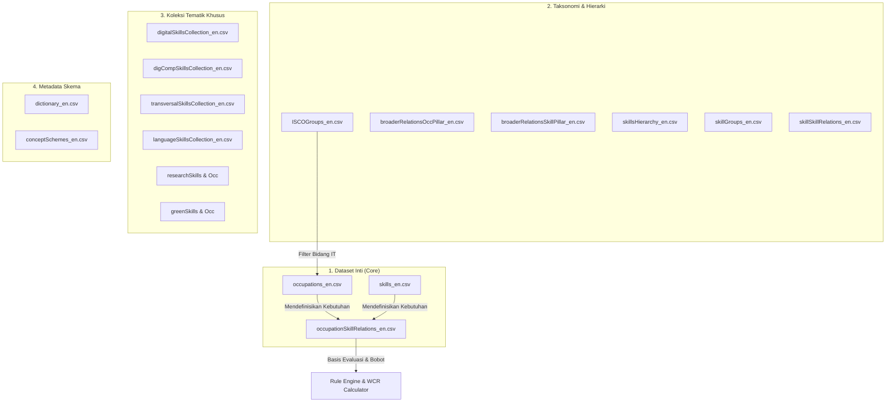

# Panduan dan Penjelasan Dataset ESCO (v1.2.1)
## untuk Expert System Evaluasi Kurikulum Akademik Berbasis Kompetensi

> **Terkait dengan:** [rencana_expert_system_evaluasi_kurikulum.md](file:///d:/PELAJARAN/Semester%205/KBR/ESCO%20dataset%20-%20v1.2.1%20-%20classification%20-%20en%20-%20csv/rencana_expert_system_evaluasi_kurikulum.md)  
> **Versi Dataset:** ESCO v1.2.1 (Classification - English - CSV)  
> **Tujuan:** Menjelaskan fungsi, isi teknis, serta peran masing-masing file dataset ESCO dalam perancangan basis pengetahuan (*knowledge base*), inferensi, dan evaluasi kurikulum akademik di bidang IT.

---

## 1. Pendahuluan

Sistem pakar yang dirancang bertujuan untuk mengevaluasi keselarasan antara kurikulum akademik (mata kuliah, SKS, CPL, CPMK, RPS, dan materi) dengan profil kompetensi pekerjaan di dunia kerja, khususnya di bidang *Information Technology* (IT).

Klasifikasi **ESCO (*European Skills, Competences, Qualifications and Occupations*)** menyediakan tiga pilar utama:
1. **Occupations** (Pekerjaan)
2. **Skills & Knowledge** (Keterampilan dan Pengetahuan)
3. **Relations & Hierarchies** (Relasi antarpilar dan pohon taksonomi)

Seluruh file CSV yang tersedia dikelompokkan ke dalam 4 kategori fungsional berikut:



---

## 2. Rincian Dataset dan Kegunaannya

---

### KELOMPOK 1: Dataset Inti (*Core Datasets* — Prioritas Tahap Prototipe / MVP)

Dataset ini adalah fondasi paling esensial. Anda wajib memuat ketiga file ini pada tahap awal pengembangan (*Fase 1 & 2*).

#### 1. `occupations_en.csv`
* **Status**: 🔴 **Wajib (Fondasi Utama)**
* **Definisi**: Katalog master seluruh profesi/pekerjaan standar yang diakui ESCO.
* **Kolom Kunci**:
  * `conceptUri`: ID unik pekerjaan (contoh: `http://data.europa.eu/esco/occupation/00030d09...`).
  * `preferredLabel`: Nama baku pekerjaan (contoh: `software developer`, `data scientist`).
  * `altLabels`: Nama alias/sinonim peran di industri (berguna untuk pencarian cerdas).
  * `iscoGroup`: 4 digit kode ISCO-08 pengelompokan pekerjaan.
  * `description`: Penjelasan tugas dan tanggung jawab pekerjaan tersebut.
* **Fungsi dalam Sistem Pakar**:
  * Menjadi katalog pekerjaan target yang akan dievaluasi terhadap kurikulum.
  * Penyaringan profesi khusus IT menggunakan kode `iscoGroup`.

---

#### 2. `skills_en.csv`
* **Status**: 🔴 **Wajib (Fondasi Utama)**
* **Definisi**: Kamus master seluruh unit kompetensi, keterampilan praktis, dan materi pengetahuan.
* **Kolom Kunci**:
  * `conceptUri`: ID unik kompetensi.
  * `preferredLabel`: Nama baku kompetensi (contoh: `SQL`, `computer programming`, `manage cloud data`).
  * `skillType`: Memisahkan antara **`knowledge`** (teori/pengetahuan) dan **`skill/competence`** (keterampilan praktis).
  * `reuseLevel`: Luas cakupan (`sector-specific`, `cross-sector`, `transversal`).
  * `altLabels` & `description`: Uraian lengkap mengenai kompetensi tersebut.
* **Fungsi dalam Sistem Pakar**:
  * Menjadi acuan dasar untuk entitas `Competency` (*Canonical Competency Layer*).
  * Memvalidasi apakah mata kuliah memenuhi ranah kognitif (*knowledge*) atau ranah psikomotorik/aplikatif (*skill*).
  * Teks deskripsi dan sinonim digunakan oleh modul pencocokan teks untuk mendeteksi kesesuaian silabus/RPS.

---

#### 3. `occupationSkillRelations_en.csv`
* **Status**: 🔴 **Wajib (Jantung Sistem Evaluasi)**
* **Definisi**: Tabel relasi yang menghubungkan setiap pekerjaan dengan kompetensi yang dibutuhkannya.
* **Kolom Kunci**:
  * `occupationUri` & `occupationLabel`: Identitas pekerjaan target.
  * `skillUri` & `skillLabel`: Identitas kompetensi yang dibutuhkan.
  * `skillType`: Tipe kompetensi (`knowledge` vs `skill/competence`).
  * `relationType`: Derajat kebutuhan kompetensi:
    * **`essential`**: Kompetensi wajib/inti yang mutlak harus dikuasai.
    * **`optional`**: Kompetensi pelengkap atau nilai tambah.
* **Fungsi dalam Sistem Pakar**:
  * **Sumber Pengetahuan Utama**: Menjawab pertanyaan *"Skill apa saja yang wajib diajarkan kurikulum jika ingin lulusannya siap menjadi IT Specialist X?"*.
  * **Dasar Pembobotan Awal**: Kompetensi `essential` diberi bobot dasar lebih tinggi daripada `optional`.
  * **Deteksi Kesenjangan Kritis (*Critical Gap*)**: Jika kompetensi berstatus `essential` bernilai cakupan 0 pada kurikulum, sistem langsung menandainya sebagai *Critical Gap*.

---

### KELOMPOK 2: Taksonomi, Hierarki & Relasi (*Knowledge Graph & Reasoning*)

Dataset ini memperkaya relasi semantik, memungkinkan sistem pakar melakukan inferensi bertingkat (*hierarchical reasoning*), dan menyaring domain IT.

#### 4. `ISCOGroups_en.csv`
* **Status**: 🟡 **Sangat Disarankan (Filter IT)**
* **Definisi**: Klasifikasi standar baku jabatan internasional (*International Standard Classification of Occupations*).
* **Kolom Kunci**: `code`, `conceptUri`, `preferredLabel`, `description`.
* **Fungsi dalam Sistem Pakar**:
  * Membatasi cakupan sistem agar hanya memproses pekerjaan IT.
  * Kode fokus:
    * **`25`**: *Information and Communications Technology Professionals* (Software Developer, System Analyst, Database Designer, Network Specialist, dll).
    * **`35`**: *Information and Communications Technicians* (IT Support, Network Operations, Web Administrator).

---

#### 5. `broaderRelationsOccPillar_en.csv`
* **Status**: 🟡 **Pendukung Struktur**
* **Definisi**: Struktur pohon relasi induk-anak (*parent-child*) pekerjaan ke grup ISCO.
* **Kolom Kunci**: `conceptUri`, `conceptLabel`, `broaderType`, `broaderUri`, `broaderLabel`.
* **Fungsi dalam Sistem Pakar**:
  * Membangun hierarki navigasi di Knowledge Graph (misal: Rumpun `ISCO 251` $\to$ Sub-rumpun `2512` $\to$ Pekerjaan `Web Developer`).

---

#### 6. `broaderRelationsSkillPillar_en.csv` & `skillsHierarchy_en.csv`
* **Status**: 🟡 **Sangat Disarankan (Aturan Inferensi)**
* **Definisi**: Pohon taksonomi hierarki keterampilan dari level umum (Level 0) hingga level sangat spesifik (Level 3).
* **Kolom Kunci**: `conceptUri`, `broaderUri`, atau Level 0 s.d. Level 3 URI & Label.
* **Fungsi dalam Sistem Pakar (Rule Engine)**:
  * **Inferensi Generalisasi**: Jika kurikulum mengajarkan *PostgreSQL* (spesifik), sistem dapat menginferensi bahwa kurikulum tersebut secara implisit juga mencakup *Relational Database Management Systems* (umum).
  * **Inferensi Agregasi**: Mengelompokkan capaian belajar kurikulum ke kategori besar saat menghasilkan laporan evaluasi.

---

#### 7. `skillGroups_en.csv`
* **Status**: 🟡 **Pendukung Pengelompokan**
* **Definisi**: Master kategori kelompok skill berdasarkan klasifikasi pendidikan resmi (ISCED-F).
* **Kolom Kunci**: `conceptUri`, `preferredLabel`, `code`, `description`.
* **Fungsi dalam Sistem Pakar**:
  * Mengelompokkan hasil analisis kurikulum ke dalam bidang studi (contoh: *Database and network design*, *Software and applications development*).

---

#### 8. `skillSkillRelations_en.csv`
* **Status**: 🟢 **Pengayaan Tingkat Lanjut**
* **Definisi**: Hubungan antarketerampilan (keterampilan A memiliki keterkaitan dengan pengetahuan B).
* **Kolom Kunci**: `originalSkillUri`, `relationType`, `relatedSkillUri`.
* **Fungsi dalam Sistem Pakar**:
  * Mengecek prasyarat materi (misal: apakah kurikulum mengajarkan *Machine Learning* tanpa terlebih dahulu memberikan mata kuliah dasar *Linear Algebra / Statistics*).

---

### KELOMPOK 3: Koleksi Tematik Terkurasi (*Thematic Collections*)

Dataset ini adalah subset terfilter yang disiapkan ESCO untuk kebutuhan pemetaan cepat pada bidang tertentu.

#### 9. `digitalSkillsCollection_en.csv`
* **Status**: 🟡 **Sangat Direkomendasikan untuk Domain IT**
* **Definisi**: Koleksi ~1.200+ kompetensi dan materi pengetahuan yang murni berkaitan dengan ranah digital dan komputer.
* **Fungsi dalam Sistem Pakar**:
  * Memastikan bahwa materi kuliah yang dievaluasi relevan secara teknis (*hard skills* IT), seperti bahasa pemrograman, arsitektur cloud, keamanan siber, dan rekayasa perangkat lunak.

---

#### 10. `transversalSkillsCollection_en.csv`
* **Status**: 🟡 **Sangat Direkomendasikan untuk Evaluasi CPL**
* **Definisi**: Koleksi keterampilan lintas disiplin (*soft skills*), seperti *critical thinking*, *problem-solving*, komunikasi, kerja sama tim, dan etika profesi.
* **Fungsi dalam Sistem Pakar**:
  * Kurikulum perguruan tinggi di Indonesia memiliki Capaian Pembelajaran Lulusan (**CPL**) aspek Sikap dan Keterampilan Umum.
  * File ini menjadi jembatan pemetaan untuk mengevaluasi apakah kurikulum juga membentuk karakter profesional mahasiswa, bukan hanya kemampuan *coding*.

---

#### 11. `digCompSkillsCollection_en.csv`
* **Status**: 🟢 **Pendukung MKU/Dasar**
* **Definisi**: Keterampilan literasi digital dasar berdasarkan kerangka kerja *DigComp* Uni Eropa.
* **Fungsi dalam Sistem Pakar**:
  * Berguna saat mengevaluasi mata kuliah dasar semester 1-2 (misal: Literasi TIK, Pengantar Teknologi Informasi).

---

#### 12. Koleksi Tambahan Lainnya
* **`languageSkillsCollection_en.csv`**: Keterampilan linguistik/bahasa asing. Berguna untuk mengevaluasi mata kuliah *English for IT / Technical Writing*.
* **`researchSkillsCollection_en.csv` & `researchOccupationsCollection_en.csv`**: Keterampilan penelitian dan metodologi ilmiah. Berguna saat mengevaluasi mata kuliah *Metodologi Penelitian* atau kesiapan skripsi/tugas akhir.
* **`greenSkillsCollection_en.csv` & `greenShareOcc_en.csv`**: Keterampilan terkait keberlanjutan dan lingkungan hidup (*Green IT / Green Data Center*). Bersifat elektif/masa depan.

---

### KELOMPOK 4: Kamus Data & Skema Konsep (*Metadata*)

#### 13. `dictionary_en.csv`
* **Status**: ℹ️ **Referensi Pengembang**
* **Definisi**: Kamus data resmi yang memuat penjelasan setiap nama kolom (*header*), format data, dan padanan properti ontologi RDF/SKOS.
* **Fungsi**: Rujukan saat Anda merancang skema tabel database (PostgreSQL/MySQL) atau struktur node di Neo4j.

#### 14. `conceptSchemes_en.csv`
* **Status**: ℹ️ **Metadata Ontologi**
* **Definisi**: Menyimpan metadata skema konsep standar. Digunakan jika sistem dikembangkan menggunakan teknologi Semantic Web (SPARQL/OWL).

---

## 3. Strategi Integrasi dengan Alur Sistem Pakar

Berdasarkan tahapan pada dokumen rencana proyek, berikut cara mengintegrasikan dataset-dataset tersebut:

```
[Filter Data IT]
  ISCOGroups (Kode 25xx & 35xx)
  └── occupations_en.csv
        │
        ▼
[Profil Kebutuhan Pekerjaan]
  occupationSkillRelations_en.csv ──(essential / optional)
  ├── skills_en.csv
  └── digitalSkillsCollection_en.csv
        │
        ▼
[Penghubung Kurikulum]
  transversalSkillsCollection (CPL Sikap/Umum)
  broaderRelationsSkillPillar (Generalisasi materi RPS)
        │
        ▼
[Rule Engine & Inferensi]
  Rubrik Cakupan (C_i: 0.0 - 1.0)
  Bobot Pekerjaan (w_i berdasarkan 'essential' + O*NET Importance)
        │
        ▼
[Keluaran Evaluasi]
  • Weighted Coverage Rate (WCR)
  • Critical Gaps
  • Rekomendasi Pembaruan RPS / Kurikulum
```

### Rekomendasi Tahap Implementasi Awal (Fase Prototipe)
1. **Gunakan 3 file inti terlebih dahulu:** [occupations_en.csv](file:///d:/PELAJARAN/Semester%205/KBR/ESCO%20dataset%20-%20v1.2.1%20-%20classification%20-%20en%20-%20csv/occupations_en.csv), [skills_en.csv](file:///d:/PELAJARAN/Semester%205/KBR/ESCO%20dataset%20-%20v1.2.1%20-%20classification%20-%20en%20-%20csv/skills_en.csv), dan [occupationSkillRelations_en.csv](file:///d:/PELAJARAN/Semester%205/KBR/ESCO%20dataset%20-%20v1.2.1%20-%20classification%20-%20en%20-%20csv/occupationSkillRelations_en.csv).
2. **Saring hanya pekerjaan bidang IT:** Gunakan prefix kode ISCO `25` (Profesional TIK) dan `35` (Teknisi TIK).
3. **Manfaatkan `digitalSkillsCollection_en.csv` dan `transversalSkillsCollection_en.csv`:** Untuk memisahkan mana bukti kurikulum yang menyasar keterampilan teknis (*hard skills*) dan mana yang menyasar keterampilan umum (*soft skills*).
4. **Jadikan relasi `essential` sebagai prioritas gap analysis:** Jika kompetensi berstatus `essential` bernilai cakupan kurikulum $C_i = 0$, jadikan item tersebut prioritas tertinggi dalam rekomendasi perbaikan kurikulum.
